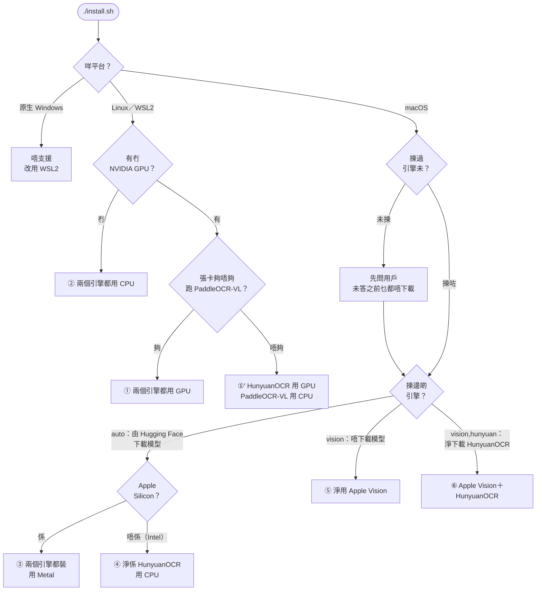
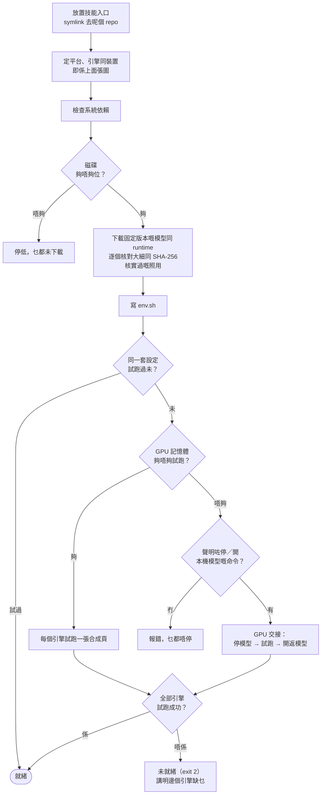
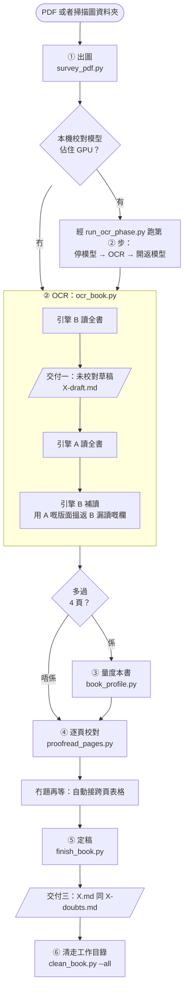
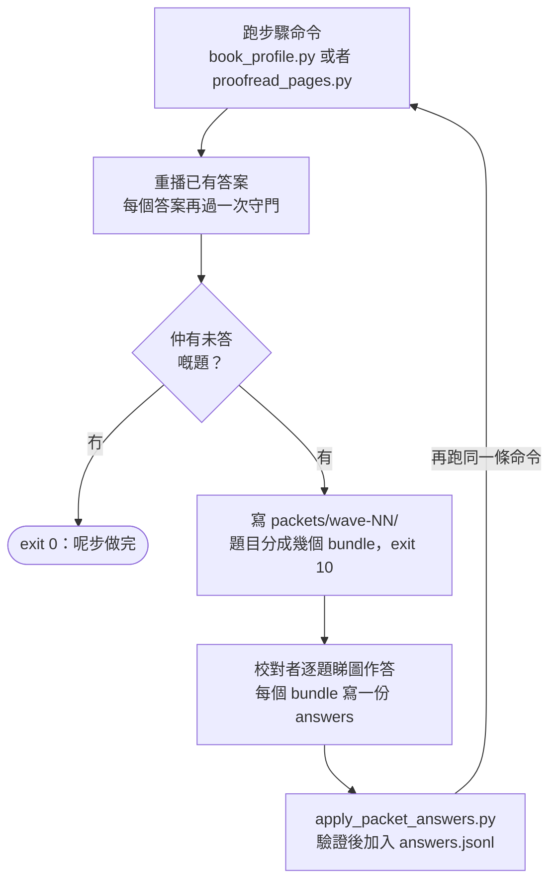
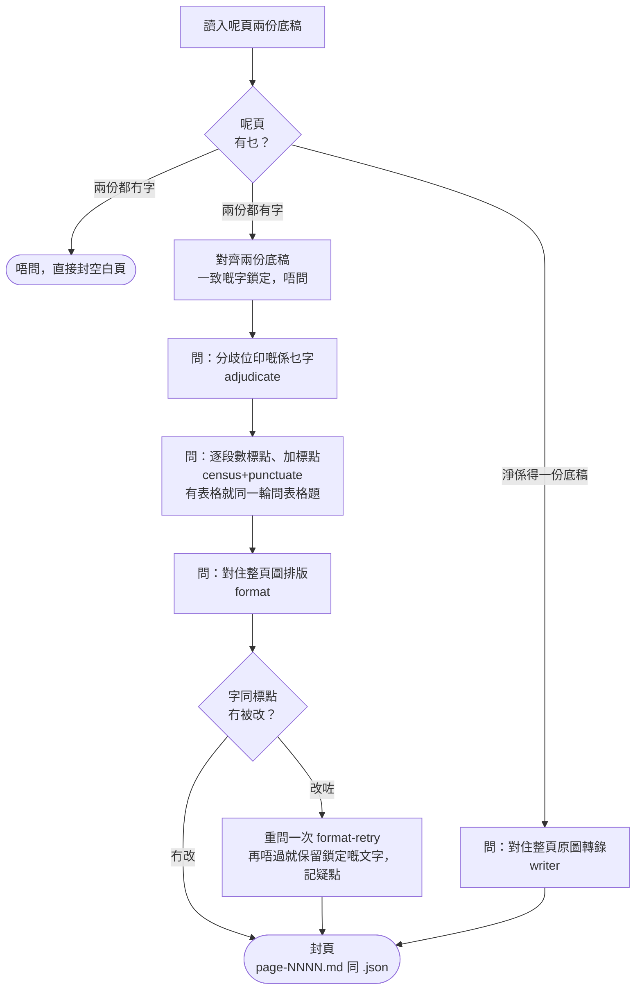

# 粵文 OCR 校對

一份通用 [Agent Skill](https://agentskills.io/specification)：用原掃描圖像，將歷史中文 PDF 忠實轉錄、校對成 Markdown。Repo 根目錄就係技能目錄，`SKILL.md`、`scripts/` 同 `references/` 只有一份，Codex、Claude Code、Gemini CLI、Antigravity、Qwen Code 或其他支援技能嘅 agent 都可以載入。

## 一眼睇晒

成個流程得三個角色，分工固定：

| 角色 | 係乜 | 做乜 |
|---|---|---|
| **腳本** | `scripts/` 入面嘅 Python | 行流程、對齊底稿、出題、做所有決定論檢查、封頁、組裝 |
| **OCR 引擎** | HunyuanOCR、PaddleOCR-VL、Apple Vision，全部喺本機跑 | 淨係出底稿；底稿唔係答案 |
| **校對者** | 預設係調用技能嘅 agent；亦可以係本機模型 | 淨係答腳本問嘅題：睇裁圖定讀法、加標點、排版 |


下面分三節講清楚：[安裝點樣決定裝乜](#安裝)、[跑一本書經過邊幾步](#跑一本書)、[逐頁校對同每個 wave 問乜](#逐頁校對同-wave)。

## 安裝

支援 Linux、macOS 同 Windows WSL2；唔支援原生 Windows。先 clone 呢個 repo，喺 repo 根目錄執行：

```bash
./install.sh --agent claude
```

`--agent` 可以重複，亦可以換成 `codex`、`gemini`、`antigravity`、`qwen`（Qwen Code）或者 `generic`。

### 安裝器點樣決定裝乜

安裝器按三樣嘢揀路線：**平台**、**（macOS）你揀邊啲引擎**、**有冇用得嘅 GPU**。圖入面每個終點有個編號，對應下面張表。



| 路線 | 引擎 A（版面同第一份底稿） | 引擎 B（第二份底稿） | 由 Hugging Face 下載 | 約佔磁碟 | 跑書流程 |
|---|---|---|---|---:|---|
| ① Linux／WSL2，NVIDIA GPU 夠用 | PaddleOCR-VL，GPU | HunyuanOCR，CUDA | 兩個模型 | 約 12 GB | 雙引擎 |
| ①′ Linux／WSL2，有 NVIDIA GPU 但唔夠用 | PaddleOCR-VL，CPU | HunyuanOCR，CUDA | 兩個模型 | 介乎 ① 同 ② | 雙引擎 |
| ② Linux／WSL2，冇 NVIDIA GPU | PaddleOCR-VL，CPU | HunyuanOCR，CPU | 兩個模型 | 約 6 GB | 雙引擎 |
| ③ Apple Silicon，`--engine auto` | PaddleOCR-VL：macOS 14 或以上用 MLX（Metal 識字、CPU 做版面）；舊 macOS 全程 CPU | HunyuanOCR，Metal | 兩個模型 | 約 5.7 GB，MLX 另加約 2.2 GB | 雙引擎 |
| ④ Intel Mac，`--engine auto` | 裝唔到（PaddlePaddle 冇啱用嘅 macOS x86_64 版本） | HunyuanOCR，CPU | 一個模型 | 約 2.4 GB | 單引擎 |
| ⑤ macOS，`--engine vision` | Apple Vision（系統內置） | 冇 | 唔下載 | 0.2 GB 以內 | 單引擎 |
| ⑥ macOS，`--engine vision,hunyuan` | Apple Vision | HunyuanOCR，Metal（Intel 用 CPU） | 一個模型 | 約 2.4 GB | 雙引擎，淨係啱橫排 |

每個判斷實際睇乜：

- **平台**：淨係認 Linux 同 macOS。WSL2 當 Linux 處理；原生 Windows 即刻停低，叫你喺 WSL2 入面跑。
- **Linux／WSL2 唔會問你揀引擎**：冇內置 OCR，兩個引擎一定都裝。
- **有冇 NVIDIA GPU**：淨係睇 `nvidia-smi` 答唔答到，唔使裝 CUDA toolkit。AMD、Intel 等非 NVIDIA GPU 暫時當冇 GPU。
- **張卡夠唔夠跑 PaddleOCR-VL**，三樣都要過：
  - compute capability 7.0 或以上；
  - 總顯存約 11.5 GiB 或以上（compute capability 低過 8.0 嘅卡冇 bf16，要約 23 GiB）；
  - driver 啱到 Paddle 其中一個 CUDA wheel（最低 520.61.05）。

  有一樣唔過，PaddleOCR-VL 就用 CPU，HunyuanOCR 照用 GPU（路線 ①′）。
- **macOS 首次安裝一定先問**，未答之前唔下載任何模型：
  - 喺 terminal 跑：列出兩個選擇同各自要幾多磁碟，等你答。
  - 由 agent 跑（冇 terminal）：exit `2` 停低；agent 要問咗用戶，再加 `--engine` 重跑，唔准代用戶揀。
  - 問題淨係問 `auto` 定 `vision`；`vision,hunyuan` 同 `hunyuan` 要自己明確傳。
  - 揀過一次就記入 `env.sh`，之後唔再問。
- **Apple Vision** 唔下載模型，但要 Apple Command Line Tools（`swiftc`）。
- **明確覆蓋**：`--device cpu` 全部用 CPU；`--engine hunyuan` 淨裝 HunyuanOCR；`--paddle-vl-backend native` 喺 Apple Silicon 唔用 MLX。自動揀到嘅 CPU 唔會寫死，下次安裝會重新偵測。

```bash
# macOS：直接講明揀邊個，唔使答問題。
./install.sh --agent claude --engine auto            # 路線 ③ 或者 ④
./install.sh --agent claude --engine vision          # 路線 ⑤
./install.sh --agent claude --engine vision,hunyuan  # 路線 ⑥

# 明確覆蓋。
./install.sh --agent claude --engine hunyuan         # 細機淨裝 HunyuanOCR
./install.sh --agent claude --device cpu             # 全部用 CPU

# 同時裝畀幾個 agent；或者傳任意「技能集合」目錄（取代 --agent 嘅位置）。
./install.sh --agent codex --agent gemini --agent antigravity --agent qwen
./install.sh --skill-dir /path/to/agent/skills

# 只讀檢查已安裝入口、依賴、設定同已有試跑證據。
./install.sh --agent claude --check
```

### 安裝器由頭到尾做乜



- **放置技能**：`--agent` 嘅目錄入面放一個指去呢個 repo 嘅 symlink，唔係複製，所以唔好刪走個 repo。`--env-only` 跳過呢步；`--skill-only` 淨做呢步。
- **下載**：用 uv 嘅 Python 3.12 建立獨立 venv。HunyuanOCR 固定 BF16 模型同 projector，`llama.cpp` 用固定 release 嘅現成二進制，冇合適二進制先用源碼建置同一個 commit；PaddleOCR-VL 嘅套件同權重都固定版本，預先下載，OCR 時唔會再下載。
- **試跑**：每個引擎經真實 runner 讀一張合成頁，讀到字、狀態完整先算過。試跑失敗唔會靜靜轉用 CPU。
- **GPU 交接**淨係喺你聲明咗本機校對模型嘅停／開命令先有（下面〈本機校對模型〉）。
- **缺系統套件**（例如 Poppler、Apple Command Line Tools）或者要管理員權限：安裝器列出缺項，補齊後重跑；唔會自動改顯示卡驅動。
- 設定寫入 `~/.config/jyut-ocr/env.sh`，之後每條跑書命令都先 source 佢；`./install.sh --check` 隨時只讀檢查就緒狀態。

技能入口放去邊，睇 `--agent`（可以重複）：

| 選項 | 預設個人技能目錄 |
|---|---|
| `--agent generic` | `~/.agents/skills/` |
| `--agent codex` | `~/.agents/skills/` |
| `--agent claude` | `~/.claude/skills/` |
| `--agent gemini` | `~/.gemini/skills/` |
| `--agent antigravity` | `~/.gemini/config/skills/` |
| `--agent qwen` | `~/.qwen/skills/` |

- Gemini CLI 同 Antigravity 係兩個安裝目標。
- 平台原生技能管理器通常只放置檔案，唔會初始化環境：用嗰種方式安裝之後，首次使用喺技能根目錄跑 `./install.sh --env-only`，再 `./install.sh --env-only --check`。
- 新增技能之後按平台要求重新載入技能，或者開新 session。
- `--with-agents` 先會安裝可選嘅 Codex／Claude writer／auditor adapters；冇裝亦可以用普通 worker 或者順序處理，見 [adapters](adapters/README.md)。

**本機校對模型**：本機有 OpenAI-compatible 模型負責校對（或者 agent 本身就行緊佢），用 `--local-model-endpoint URL --local-model-name NAME` 聲明；佢同 OCR 搶同一張 GPU 就再加 `--local-model-release-cmd` 同 `--local-model-restore-cmd`（兩個要一齊畀）。之後安裝試跑（GPU 唔夠位嗰陣）同跑書嘅 OCR 都經 GPU 交接：停模型、跑 OCR、開返模型。

全部參數、平台細節同復原見 [安裝、平台選項及復原](references/install.md)。

## 跑一本書

直接要求 agent 就得：

> 用 jyut-ocr-proofread，將呢份 PDF 全部掃描頁轉錄成 Markdown，保留原字形、標點、表格同註號，列出未能確定嘅地方。

Agent 照 `SKILL.md` 一步一個 command。下圖係預設嘅雙引擎路線：



| 步 | 腳本 | 做乜 | 問唔問校對者 | 主要輸出（喺本書目錄 `BOOK`） |
|---|---|---|---|---|
| ① 出圖 | `survey_pdf.py` | 每頁轉成圖，記低頁序同 hash | 唔問 | `renders/`、`page-manifest.json` |
| ② OCR | `ocr_book.py` | 引擎 B 讀全書 → 出未校對草稿 → 引擎 A 讀全書 → 引擎 B 補讀漏咗嘅欄 | 唔問 | `ocr-hunyuan/`、`ocr-paddle/`（或者 `ocr-vision/`）、`draft.md` |
| ③ 量度本書 | `book_profile.py` | 喺本書自己嘅頁量度：書眉頁碼、邊個引擎讀得好啲、異體字對、本書用乜標點符號 | 問 | `book-profile.json` |
| ④ 逐頁校對 | `proofread_pages.py` | 逐頁對齊兩份底稿、裁決分歧、加標點、排版、封頁；最後接跨頁表格（[下一節](#逐頁校對同-wave)） | 問 | `proofread/page-NNNN.md` 同 `.json` 封條 |
| ⑤ 定稿 | `finish_book.py` | 驗封頁同拼書 → 修書（純規則）→ 定稿同最後審核 → 疑問清單，抄去 PDF 隔籬 → 清理裁圖 | 唔問 | `final.md`、`doubts.md` |
| ⑥ 清走 | `clean_book.py --all` | 刪走成個 `BOOK`，淨係留 PDF 隔籬嘅交付檔 | 唔問 | — |

同一本書交三次（`X` 係 PDF 嘅檔名）：

1. **未校對草稿 `X-draft.md`**：引擎 B 讀完全書即刻出，唔使等引擎 A；自動抄去 PDF 隔籬。
2. **進度稿 `BOOK/proofreading.md`**：校對期間每 5 分鐘重建一次，封好嘅頁用校對稿，其餘用草稿；留喺本書目錄，唔抄。
3. **定稿 `X.md` 同疑問清單 `X-doubts.md`**：自動抄去 PDF 隔籬。定唔到嘅位全部列喺疑問清單，要對住原書核；流程唔會聲稱已逐頁視覺校對。

由掃描圖資料夾開嘅書冇 PDF：交付檔留喺 `BOOK`（`draft.md`、`final.md`、`doubts.md`），`BOOK` 唔清走。

### 其他路線

| 路線 | 幾時用 | 同上圖唔同嘅地方 |
|---|---|---|
| **Apple Vision＋HunyuanOCR**（安裝路線 ⑥） | Mac 上想快，而本書係橫排 | 引擎 A 換成 Apple Vision，底稿喺 `ocr-vision/`，第 ③ ④ 步嘅 `ocr-paddle` 換成 `ocr-vision`；其餘一樣。呢條路線淨係啱橫排 |
| **單引擎**（安裝路線 ④ ⑤，或者明確 `--single-engine`） | 部機淨係得一個引擎 | 第 ② 步淨係一個引擎讀（淨用 Apple Vision 就冇未校對草稿）；跳過第 ③ 步；第 ④ 步每頁對住原圖轉錄，底稿只係提示；第 ⑤ 步唔修書，工作檔留低 |
| **本機模型校對**（`--backend http`） | 有本機 OpenAI-compatible 模型；agent 本身就係嗰個模型就一定要用 | 第 ③ ④ 步由腳本直接問模型，頁圖唔入 agent 嘅 context，亦冇 wave |
| **GPU 交接** | 本機校對模型同 OCR 搶同一張 GPU | 第 ② 步經 `run_ocr_phase.py` 跑：等模型其他 client 做完先停模型，OCR 跑完再開返 |

手動跑嘅命令（喺技能根目錄，用安裝器配置嘅 `JYUT_OCR_PYTHON`）：

```bash
. "${XDG_CONFIG_HOME:-$HOME/.config}/jyut-ocr/env.sh"
"$JYUT_OCR_PYTHON" scripts/survey_pdf.py /path/to/book.pdf BOOK
"$JYUT_OCR_PYTHON" scripts/ocr_book.py BOOK
"$JYUT_OCR_PYTHON" scripts/book_profile.py BOOK/renders BOOK/ocr-paddle BOOK/ocr-hunyuan BOOK/book-profile.json
"$JYUT_OCR_PYTHON" scripts/proofread_pages.py BOOK/renders BOOK/ocr-paddle BOOK/proofread --draft2-directory BOOK/ocr-hunyuan
"$JYUT_OCR_PYTHON" scripts/finish_book.py BOOK
```

長步驟放背景，用 `scripts/wait_for_run.py` 等。完整流程、exit 碼同續跑見 [`SKILL.md`](SKILL.md)；各步細節、每類疑點同開關見 [跑書流程](references/long-book-workflow.md)；引擎、裝置同 GPU 交接見 [本機 OCR](references/local-ocr.md)；冇可用 OCR 引擎、要人手分段轉錄見 [人手分段同 structured 定稿](references/structured-workflow.md)。

## 逐頁校對同 wave

第 ③ 步（量度本書）同第 ④ 步（逐頁校對）遇到要睇圖先定到嘅位，腳本唔會自己決定，而係出題問校對者。

### 邊個答題

| | A 套：當前 agent（預設） | B 套：本機模型 |
|---|---|---|
| 開關 | `--backend packet` | `--backend http` |
| 點問 | 腳本將題目寫成檔案就停低（exit `10`），等 agent 睇圖作答 | 腳本經 `PROOFREAD_ENDPOINT` 直接問模型，一次跑到尾 |
| 有冇 wave | 有 | 冇 |
| 頁圖入唔入 agent 嘅 context | 入：agent 自己睇裁圖 | 唔入 |

Agent 本身就係嗰個本機模型（例如 Qwen Code 配本機 Qwen）就一定行 B 套：腳本認得出就預設 http、拒絕 packet。

### 乜嘢係 wave

**Wave 即係一輪題目。** 腳本每次跑都由頭重播已有嘅答案，行到要等新答案先行得落去嘅位就停。嗰一刻全部頁一共欠嘅題，就係一個 wave。



- **點解要分幾輪**：一條題要等佢依賴嘅答案齊咗先問得。要定咗字先可以加標點，要加咗標點先可以排版，所以一頁唔會一次過問晒，每個 wave 推進一步。
- **一個 wave 入面唔同頁可以喺唔同階段**：有啲頁仲問緊裁決，有啲已經問到排版。
- **Wave 數唔固定**：睇本書有幾多分歧、表格同重試，成本書要行嘅輪數由最慢嗰頁決定。
- **Bundle**：一個 wave 嘅題按頁序平均分成 bundle 檔，預設分 8 份（題少過 8 條就一題一份），每份最多 20 題，超過就多開幾份。Agent 可以自己順序答，亦可以一個 subagent 答一個 bundle；答齊成個 wave 先交。
- **唔會重複問**：答案只加唔改。斷咗、開新 session 再跑同一條命令，已答嘅題直接重播。題目綁定圖、prompt 同影響答案嘅設定，唔綁腳本 bytes，所以改 code 唔會令已答嘅題作廢。
- **exit `11`**：有 wave 等答，同時有頁失敗或者被擋；照答，再按報告處理嗰幾頁。

### 一頁經過邊幾輪

預設雙引擎嘅一頁，由讀入底稿到封頁：



圖入面每個「問」通常係一輪。典型情況：

| 頁嘅情況 | 第 1 輪 | 第 2 輪 | 第 3 輪 | 之後 |
|---|---|---|---|---|
| 普通正文頁 | `adjudicate` | `census+punctuate` | `format` | 封頁 |
| 兩個引擎冇分歧 | `census+punctuate` | `format` | 封頁 | |
| 有表格 | `adjudicate` | `census+punctuate`，加 `table-rebuild` 或者 `orient` | 表格後續題 | 表格全部定咗先問 `format` |
| 淨係得一份底稿 | `writer` | 封頁 | | |
| 空白頁 | 唔問，第一次跑就封 | | | |

守門唔過嘅重試題（`punctuate-retry`、`table-rebuild-retry`、`format-retry`）會多一輪。

每種題問乜、答案點樣驗：

| 題型（`kind`） | 幾時問 | 問乜 | 腳本點樣守門 |
|---|---|---|---|
| `adjudicate` | 兩個引擎讀法唔同，而規則定唔到。已知異體、書眉、括號同符號嘅分歧由規則處理，唔問 | 睇分歧位嘅裁圖，答印嘅係乜字；每頁最多 24 題 | 答案唔可以靜靜刪走引擎讀到嘅字 |
| `coverage-read` | 裁決答「呢度冇印字」 | 盲讀同一張裁圖 | 證實唔到係空，就保留引擎嘅讀法，記疑點 |
| `census+punctuate` | 每段正文。書眉、表格同兩個引擎標點一致嘅段唔問 | 數印咗幾多處標點，再加入鎖定嘅字。B 套分開問 `census` 同 `punctuate` | 字要一個不差，標點數要對得上點算。唔過就 `punctuate-retry` 一次，雙圈對唔上問 `punctuate-shape`；再唔過就淨係留兩次答案一致嘅標點（冇就唔加），記疑點 |
| `table-rebuild` | 版面有表，但引擎冇讀成可靠嘅格網 | 對住裁圖重建成表 | 淨係可以用引擎讀到嘅字，兩個引擎都讀到嘅字唔可以漏。唔過就 `table-rebuild-retry` 一次 |
| `orient`、`record-order`、`cell-direction` | 表格嘅讀向用規則定唔到 | 直排定橫排、記錄次序、格內方向 | `cell-direction` 掉轉選項問兩次，兩次一致先收 |
| `format` | 字、標點同表格都定咗之後 | 對住整頁圖加標題、段落、列表，擺返表格，刪書眉同頁碼 | 唔准加字、刪字、改標點（`verify_characters` 等）。唔過就 `format-retry` 一次；再唔過保留鎖定嘅文字，記疑點 |
| `writer` | 嗰頁淨係得一份底稿，或者冇漢字但有西文、數字 | 對住整頁原圖轉錄，底稿只係提示 | 空答案當嗰頁失敗 |
| `page-inventory`、`content-recovery`、`coverage-review` | 淨係開咗 `--content-fidelity on` | 整頁清點（最先問）、排版前補讀、最後覆核 | 定唔到就記疑點照封；每題最多改一次 |
| `notation` | 第 ③ 步量度本書 | 抽樣頁嘅段落印咗乜符號 | — |

第 ③ 步量度本書一樣行 wave：佢抽樣問 `adjudicate`（量度邊個引擎讀呢本書讀得好啲）同 `notation`；書眉頁碼同異體字對唔使問。

幾個例外：

- **兩個引擎嘅閱讀次序對唔上**（例如直排題名頁一個引擎亂咗欄序）：逐字對齊冇意義，成頁用偏好嗰個引擎嘅讀法。
- **缺引擎 B 底稿嘅頁**：唔封，當失敗，報告列出頁碼；等 OCR 讀完再跑同一條命令。
- **失敗或者被擋嘅頁**唔會阻住其他頁。
- **守門唔過、定唔到嘅位**全部記入疑點，照封頁，唔當失敗；成個 run 冇一步要等人。

冇題再等之後，`proofread_pages.py` 自動接跨頁表格（唔問模型）。每種題點答、subagent 點分工，見 [subagent 分工同 packet 答題契約](references/subagent-orchestration.md)。

## 內容保留同驗證

- 原掃描圖像係最終依據；引擎一致、文字通順、測試通過同 hash seals 都唔等於原文正確。
- 輸出跟評測規則：只刪書眉、頁碼、版心、印章、索書號、條碼同館藏印；保留原字形、數字、外文、算式、原印項號與註號、舊標點；雙圈句號寫 `。。`，字面星號寫 `\*`；交付稿冇頁碼分隔。
- 註腳：引用 `[^n]` 留喺原位，保留原印編號，重用嘅原印號改用 `[^n-2]` 呢類唯一 ID；定義預設留喺頁底；配唔上嘅一半照原印留低，記做疑點。
- 表格：橫排表保持原行列，直排表由右至左嘅直欄變成由上至下嘅行；冇表頭或者有合併格用 HTML `<table>`；跨頁續表合併。圖表入面嘅字照轉，預設唔抽圖（`--extract-figures` 先抽）。
- 封存頁記低校對 transport、model 同 script hash 但唔用嚟判過期；舊版技能封好嘅頁同 OCR 底稿照收。OCR 底稿淨係 render、模型、runtime 同影響輸出嘅設定改咗先要重做。
- 正文／標點、閱讀次序、表格格位同識別錯誤率分開驗證。單元測試、實頁試驗、跨平台實機驗證同同條件 benchmark 亦分開報告，唔以安裝成功宣稱準確率改善。

實書嘅書名、頁碼、專名、來源句式及單一版次政策留喺 project-local 記錄，核心回歸測試用 synthetic 正反例。

## 可選人工標註

一般 OCR／校對唔需要另一個 repo。需要互動式人工對圖裁定時，可以用 `scripts/review.py` 接上 `jyut-ocr-bench` 共用介面：現行 bench（review API 2）將答案寫入 bench 自己 git 跟蹤嘅 `sample-catalogue/v1.json`，改動歷史靠 git；舊 bench（API 1）先將圖片、題目同 append-only 答案歷史留喺相應 project。本技能唔保存答案。未裝介面時仍可完成一般校對並保存疑點，唔以缺少介面為理由丟棄未定讀法。詳見 [人工標註工具](references/manual-review-tool.md)。

## 維護

```bash
python3 tests/run_all.py                    # 全套：unittest 加回歸 check
python3 tests/run_all.py --only unit        # 淨係 tests/test_*.py
python3 tests/run_all.py --only checks      # 淨係 tests/check_*.py
python3 tests/run_all.py stitch --log-dir /tmp/jyut-ocr-tests   # 揀名有 stitch 嘅檔，留低每個檔嘅輸出
```

`tests/run_all.py` 係唯一測試入口：每個檔喺自己嘅 subprocess 跑，限時 900 秒，`PROOFREAD_ENDPOINT` 指去冇人聽嘅 port，唔使 GPU、唔使模型；逐個檔印 PASS／FAIL 同總結，有一個失敗就 exit 1。`tests/check_*.py`、`tests/cases/` 同 `tests/golden/` 係回歸 check 同人手核過嘅 golden；評已校對輸出目錄嘅 `tests/run_regression.py` 同 benchmark 快照同步，見 [開發筆記](references/developer-notes.md)。

測試以合成資料及 fake runtimes 驗證契約；實際 OCR 引擎 smoke、平台原生技能發現，以及當前模型讀技能／核原圖嘅操作驗證分開記錄。成功列出技能唔等於模型已核圖；未實機驗證嘅平台唔標成已通過。版本歷史只維護喺 [CHANGELOG.md](CHANGELOG.md)。

呢份 README 嘅流程圖係 Mermaid，直接寫喺文內嘅 `mermaid` 區塊，GitHub 會自動畫出嚟；改流程之後喺度改字就得，唔使另外出圖。

```text
SKILL.md             # 通用技能入口（流程表）
install.sh           # 安裝／環境檢查入口
env.sh.example       # 本機設定樣本（安裝器寫真嘅 env.sh）
scripts/             # 安裝、OCR、packet、校對、修書及驗證工具
references/          # 按任務需要載入嘅規則
runtime/             # 固定版本清單（ocr-lock.json）
agents/              # 可選平台展示 metadata
adapters/            # 可選平台 custom-agent 設定
tests/               # 合成測試、回歸 check 同 golden（run_all.py 係入口）
```

## License

MIT
